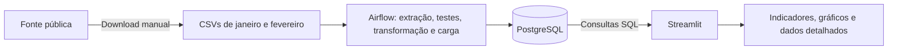

# Teste Técnico Ottrans — Análise de Demanda de Passageiros

Projeto de ETL e análise de dados públicos de demanda do transporte coletivo. Os dados de janeiro e fevereiro de 2022 são processados com Python e pandas, armazenados no PostgreSQL e apresentados em um dashboard Streamlit. O Airflow organiza a execução do pipeline, e o Docker Compose reúne o ambiente local.

**Estado atual:** ETL, DAG, seis testes de transformação e dashboard implementados. As cinco consultas analíticas em arquivos SQL, a integração automatizada com a fonte e a publicação ainda têm pendências descritas neste documento.

| Acesso | Endereço ou situação |
| --- | --- |
| Dashboard local | <http://127.0.0.1:8501> |
| Airflow local | <http://127.0.0.1:8080> |
| Dashboard público | Pendente de publicação; inserir a URL após o deploy. |
| Repositório | [GitHub — Teste Técnico Ottrans](https://github.com/matheus-dataeng/Teste_Tecnico_Desenvolvedor_Jr_Ottrans) |

## Arquitetura



O ambiente local possui três serviços principais: PostgreSQL, Airflow e Streamlit. O serviço de testes é executado sob demanda.

O Streamlit consulta o PostgreSQL diretamente. A aplicação não possui uma API própria. O consumo de uma API externa da fonte de dados é um requisito separado e ainda precisa ser implementado no processo de extração.

### Fluxo do ETL

A DAG `Teste_Tecnico_Ottrans`, em [dags_airflow/dags.py](dags_airflow/dags.py), executa:

```text
extract → test_transform → transform → load
```

1. **extract:** lê os dois CSVs e retorna os DataFrames.
2. **test_transform:** executa os seis testes de transformação com dados pequenos criados em memória. Essa tarefa testa as funções; ela não valida diretamente o conteúdo dos CSVs extraídos.
3. **transform:** padroniza os nomes das colunas, remove duplicatas completas, trata textos, converte códigos numéricos e padroniza datas.
4. **load:** abre uma transação e carrega as duas tabelas no PostgreSQL. Quando a tabela já existe, seu conteúdo é substituído com `TRUNCATE` seguido de inserção em lotes de 5.000 registros.

Os DataFrames passam entre as tarefas por XCom. A conexão com o banco é criada na tarefa de carga e liberada ao final. Uma exceção na carga desfaz as operações da transação. A falha de uma tarefa interrompe as tarefas seguintes nessa sequência.

A execução é manual (`schedule=None`), com `catchup=False`. O Airflow funciona em modo `standalone`: seus metadados ficam em SQLite no volume `airflow_data`; os dados de negócio ficam no PostgreSQL, no volume `postgres_data`.

### Estrutura do banco

Cada arquivo mensal corresponde a uma tabela no schema `public`:

| Campo de janeiro — `demanda_janeiro_2022` | Campo de fevereiro — `demanda_fevereiro_2022` | Significado |
| --- | --- | --- |
| `data_movimento_jan` | `data_movimento_fev` | Data do registro |
| `codigo_linha_jan` | `codigo_linha_fev` | Código da linha de ônibus |
| `nome_linha_jan` | `nome_linha_fev` | Nome da linha |
| `tipo_passageiro_jan` | `tipo_passageiro_fev` | Código da categoria de passageiro |
| `nome_passageiro_jan` | `nome_passageiro_fev` | Descrição da categoria de passageiro |
| `demanda_jan` | `demanda_fev` | Volume de demanda informado no registro |

Um registro contém uma combinação de data, linha e categoria de passageiro. A demanda representa o volume registrado; não permite identificar pessoas únicas.

As páginas usam aliases SQL para receber nomes de colunas iguais nos resultados dos dois meses. Ao selecionar ambos os meses, os resultados são concatenados em memória. As tabelas mensais permanecem separadas no banco.

## Tecnologias e dependências

| Tecnologia | Uso |
| --- | --- |
| Python | ETL, testes e dashboard |
| pandas | Leitura e transformação dos dados |
| PostgreSQL | Persistência e consultas SQL |
| SQLAlchemy | Conexão, transações e carga |
| psycopg | Driver do PostgreSQL |
| python-dotenv | Leitura de variáveis de ambiente pelo código |
| Apache Airflow | Orquestração das tarefas |
| Streamlit | Interface e visualizações |
| pytest | Testes automatizados |
| Docker Compose | Execução dos serviços locais |

As dependências de cada imagem ficam em `docker/requirements.*.txt`. O Airflow utiliza as constraints oficiais da sua versão. `logging`, `os` e `pathlib` fazem parte da biblioteca padrão do Python.

O `requirements.txt` da raiz reúne dependências de desenvolvimento. Ele ainda referencia FastAPI e uvicorn de uma configuração anterior, embora não exista serviço de API no Compose atual. Essa limpeza está pendente. A execução por Docker instala as dependências de cada serviço automaticamente; não exige instalar o Airflow no Windows.

## Organização do projeto

```text
.
├── consultas_analiticas/          # Cinco arquivos SQL a completar
├── dags_airflow/
│   └── dags.py                   # DAG do pipeline
├── data/                         # CSVs locais, ignorados pelo Git
├── docker/                       # Dependências por serviço
├── landing_page/                 # Apresentação estática em HTML e CSS
├── src/
│   ├── extract.py
│   ├── transform.py
│   ├── load.py
│   ├── main.py                   # Entrada alternativa com ajuste pendente
│   └── utils/log_config.py
├── streamlit_app/
│   ├── Home.py
│   ├── assets/
│   ├── pages/
│   │   ├── 1_Demanda_por_Linha.py
│   │   └── 2_Dados_Detalhados.py
│   └── secrets.toml              # Configuração local, não versionada
├── tests/test_transform.py
├── Dockerfile.airflow
├── Dockerfile.streamlit
├── Dockerfile.tests
├── docker-compose.yml
├── pytest.ini
├── requirements.txt
└── README.md
```

## Fonte e qualidade dos dados

A fonte indicada no desafio é o conjunto [Demanda, no Portal Brasileiro de Dados Abertos](https://dados.gov.br/dados/conjuntos-dados/demanda). O recorte utilizado contém os recursos de janeiro e fevereiro de 2022.

Na implementação atual, os arquivos são baixados manualmente e colocados em `data/`. A extração usa separador `;` e codificação UTF-8.

### Problemas encontrados, tratamentos e impactos

A conferência dos dois arquivos locais identificou os seguintes problemas reais:

| Problema | Evidência na base | Tratamento implementado | Impacto |
| --- | --- | --- | --- |
| Ausência de cabeçalho em janeiro | Janeiro começa diretamente com dados; fevereiro possui cabeçalho. A leitura padrão de janeiro retorna 86.033 registros, enquanto a leitura correta retorna 86.034. | `extract.py` utiliza `header=None` e informa os seis nomes de colunas para janeiro. | Preserva o primeiro registro e sua demanda, evitando que ele seja interpretado como cabeçalho. Também permite acessar corretamente os campos na transformação. |
| Formatos de data diferentes entre os meses | Janeiro utiliza `AAAA-MM-DD`; fevereiro utiliza `DD/MM/AAAA`. Uma data como `01/02/2022` é ambígua sem um formato explícito. | `validate_dates` usa `%Y-%m-%d` para janeiro e `%d/%m/%Y` para fevereiro, com conversão para datas por `.dt.date`. | Evita trocar dia e mês, mantém os registros no período correto e permite agrupamento e ordenação temporal consistentes. |
| Espaços nas extremidades dos nomes de linhas | 61.987 registros de janeiro e 58.015 de fevereiro possuem espaços no início ou no fim de `NomeLinha`: 120.002 registros ao todo. | As validações de texto aplicam `.str.strip()` aos nomes das linhas. | Padroniza os nomes exibidos e evita diferenças artificiais em buscas, comparações e agrupamentos pelo nome da linha. O tratamento preserva os valores de demanda. |

Além desses tratamentos, o código possui regras preventivas:

- Remoção de registros completamente duplicados com `drop_duplicates`.
- Preenchimento de nomes nulos com `Dado não informado`.
- Conversão dos códigos de linha e categoria para números com `errors="coerce"`, registrando avisos quando aparecem nulos após a conversão.
- Conversão de datas inválidas para valores ausentes, com teste automatizado desse comportamento.
- Padronização da capitalização dos textos com `.str.title()`.

Na conferência dos arquivos utilizados, não foram encontrados nulos nos seis campos, duplicatas completas nem datas inválidas com os formatos explícitos. Por isso, esses casos não são apresentados como problemas encontrados e corrigidos nessa amostra. A mudança de capitalização é uma escolha de apresentação; pode alterar siglas e precisa ser considerada ao interpretar os nomes.

### Valores de referência

Os arquivos conferidos apresentam estes totais:

| Período | Registros | Demanda total | Códigos de linha distintos | Dias com registros |
| --- | ---: | ---: | ---: | ---: |
| Janeiro/2022 | 86.034 | 12.495.749 | 333 | 31 |
| Fevereiro/2022 | 80.548 | 13.548.408 | 332 | 28 |
| Ambos | 166.582 | 26.044.157 | 341 | 59 |

A contagem de linhas em ambos os meses considera códigos distintos no conjunto combinado. Ela não é a soma das contagens mensais, pois vários códigos aparecem nos dois períodos.

## Instalação e execução local

### 1. Preparar o ambiente e os arquivos

Requisitos: Docker Desktop iniciado em modo de containers Linux, Docker Compose v2 e acesso à internet para baixar as imagens e dependências. Os comandos abaixo devem ser executados na raiz do repositório.

Baixe os dois recursos da fonte e salve-os com estes nomes:

```text
data/demanda_202201.csv
data/demanda_202202.csv
```

A pasta `data/` é ignorada pelo Git. Quem obtiver o repositório deve criá-la e fornecer os arquivos antes de iniciar o ETL.

### 2. Criar o arquivo `.env.docker`

Crie `.env.docker` na raiz com a configuração abaixo. A senha é um exemplo para substituir por um valor definido no seu ambiente; se o arquivo já existir, preserve sua configuração.

```dotenv
POSTGRES_DB=ottrans
POSTGRES_USER=ottrans
POSTGRES_PASSWORD=defina_uma_senha_local
POSTGRES_HOST=127.0.0.1
POSTGRES_PORT=5433
AIRFLOW_PORT=8080
STREAMLIT_PORT=8501
ARQUIVO_JANEIRO_2022=/app/data/demanda_202201.csv
ARQUIVO_FEVEREIRO_2022=/app/data/demanda_202202.csv
```

O Compose lê esse arquivo por meio de `--env-file .env.docker`. Seu bloco `environment` disponibiliza as configurações ao código dentro dos containers. Para a comunicação interna, ele fixa `POSTGRES_HOST=postgres`, `POSTGRES_PORT=5432` e os caminhos em `/app/data/`.

| Origem da conexão | Host | Porta padrão |
| --- | --- | --- |
| Ferramenta no Windows | `127.0.0.1` | `5433` |
| Airflow e Streamlit dentro do Compose | `postgres` | `5432` |

As variáveis de inicialização do PostgreSQL criam banco e usuário quando o volume é inicializado pela primeira vez. Alterar o arquivo depois não modifica automaticamente um banco, usuário ou senha já gravados no volume.

### 3. Configurar a conexão do Streamlit

Crie o arquivo local `streamlit_app/secrets.toml`:

```toml
[connections.postgresql]
dialect = "postgresql"
driver = "psycopg"
host = "postgres"
port = "5432"
database = "ottrans"
username = "ottrans"
password = "defina_uma_senha_local"
```

Use o mesmo banco, usuário e senha definidos no seu `.env.docker`. O host e a porta acima são os da rede interna do Compose. As páginas acessam essa seção usando `st.connection("postgresql", type="sql")`.

O Compose monta esse arquivo em `/app/.streamlit/secrets.toml`. `.env.docker` e `secrets.toml` são ignorados pelo Git e pelo contexto de build das imagens. Configure-os localmente antes de iniciar os serviços.

### 4. Iniciar PostgreSQL e Airflow

```powershell
docker compose --env-file .env.docker config --quiet
docker compose --env-file .env.docker up --build -d postgres airflow
docker compose --env-file .env.docker ps
```

A primeira construção pode demorar devido ao download das imagens e das bibliotecas. Aguarde os serviços ficarem saudáveis antes de disparar a DAG.

Abra <http://127.0.0.1:8080>. O usuário local é `admin`; a senha configurada no ambiente pode ser consultada no arquivo local do Airflow:

```powershell
docker compose --env-file .env.docker exec airflow cat /opt/airflow/simple_auth_manager_passwords.json.generated
```

Na interface, localize `Teste_Tecnico_Ottrans`, habilite a DAG e dispare uma execução manual. Acompanhe as tarefas `extract`, `test_transform`, `transform` e `load` até a conclusão. A carga cria as tabelas quando ainda não existem.

A entrada recomendada atualmente é a DAG. `src/main.py` ainda importa e chama `credentias`, enquanto a função em `load.py` se chama `credentials`. Esse ajuste está pendente para a execução alternativa pelo script principal.

### 5. Iniciar o dashboard

Depois de concluir a primeira carga:

```powershell
docker compose --env-file .env.docker --profile apps up --build -d streamlit
docker compose --env-file .env.docker --profile apps ps
```

Acesse <http://127.0.0.1:8501>. Os endereços usam as portas padrão; se personalizar as portas no `.env.docker`, ajuste as URLs.

O código e os CSVs são montados como somente leitura nos containers. Mudanças nos arquivos Python aparecem no ambiente sem reconstruir as imagens; alterações de dependências ou Dockerfiles exigem novo build. As consultas do dashboard ficam em cache por dez minutos, portanto uma nova carga pode não aparecer imediatamente na tela.

### Logs e encerramento

```powershell
docker compose --env-file .env.docker logs --tail 100 airflow
docker compose --env-file .env.docker --profile apps logs --tail 100 streamlit
docker compose --env-file .env.docker --profile apps stop
```

Os logs de cada tarefa também ficam disponíveis na interface do Airflow. `stop` preserva os volumes e os dados para a próxima execução.

## Dashboard

- **Home:** apresenta o projeto, o período e a fonte dos dados. A fotografia da frota OT Trans é ilustrativa e não define a localização geográfica da base utilizada.
- **Análise da demanda:** oferece filtro de janeiro, fevereiro ou ambos, três indicadores e dois gráficos.
- **Dados detalhados:** apresenta os seis campos dos registros, filtros de mês e código da linha, contagem de registros e datas no formato `DD/MM/AAAA`.

| Indicador ou visualização | Cálculo |
| --- | --- |
| Demanda total | Soma da demanda no período selecionado |
| Linhas com registros | Quantidade de códigos de linha distintos |
| Média diária de demanda | Demanda total dividida pelas datas distintas com registros; valor exibido arredondado |
| Evolução diária | Soma da demanda de todas as linhas por data |
| Ranking das dez linhas | Soma da demanda por código de linha, em ordem decrescente |

As consultas usadas nas páginas estão escritas diretamente em `conn.query`. O dashboard não lê os arquivos de `consultas_analiticas/`.

## Consultas SQL analíticas

Os cinco arquivos abaixo organizam as análises SQL do desafio. **As consultas estão em desenvolvimento e precisam ser concluídas e validadas antes da entrega.** Os cálculos em pandas e os arquivos apenas criados não substituem as cinco consultas analíticas exigidas.

| Arquivo | Análise prevista |
| --- | --- |
| [01_demanda_total.sql](consultas_analiticas/01_demanda_total.sql) | Demanda total por período |
| [02_quantidade_linhas.sql](consultas_analiticas/02_quantidade_linhas.sql) | Quantidade de linhas distintas |
| [03_media_diaria_demanda.sql](consultas_analiticas/03_media_diaria_demanda.sql) | Média diária da demanda |
| [04_demanda_por_dia.sql](consultas_analiticas/04_demanda_por_dia.sql) | Evolução temporal da demanda |
| [05_ranking_linhas.sql](consultas_analiticas/05_ranking_linhas.sql) | Ranking de demanda por linha |

Após preencher os arquivos, execute-os em um editor SQL conectado ao banco configurado no `.env.docker`, usando `127.0.0.1:5433` no computador local. Compare seus resultados com os valores de referência e os indicadores do dashboard.

## Testes automatizados

Os seis testes de [tests/test_transform.py](tests/test_transform.py) utilizam DataFrames sintéticos e verificam:

1. Remoção de duplicatas nos dois meses.
2. Limpeza dos textos e conversão dos códigos de janeiro.
3. Limpeza dos textos e conversão dos códigos de fevereiro.
4. Conversão correta dos dois formatos de data.
5. Conversão de datas inválidas para valores ausentes.
6. Erro quando falta uma coluna obrigatória no renomeamento.

Para executar pelo pytest em um container independente:

```powershell
docker compose --env-file .env.docker --profile tests run --rm --build --no-deps -T tests
```

Esse serviço não depende do PostgreSQL, do Airflow nem dos CSVs reais. A execução deve apresentar seis testes aprovados. Na DAG, as funções de teste são chamadas diretamente pela tarefa `test_transform`; esse caminho interrompe na primeira falha e não gera o relatório completo do pytest.

## Principais decisões técnicas

- **pandas para os dois arquivos:** os CSVs somam aproximadamente 13 MB, permitindo uma implementação simples em memória para este recorte.
- **PostgreSQL:** oferece persistência, transações e consultas relacionais para os indicadores, além de permitir compartilhar a base com o dashboard.
- **Uma tabela por mês:** mantém a correspondência entre arquivo de origem e tabela. O custo dessa escolha é precisar adaptar tabelas, consultas e código quando novos meses forem incluídos. Uma tabela única com uma coluna de data é uma possibilidade de evolução.
- **Substituição completa na carga:** reaplicar os mesmos arquivos substitui o conteúdo anterior, evitando acumular registros de execuções passadas. A abordagem atende ao recorte fixo; não implementa carga incremental.
- **Funções separadas por etapa:** extração, transformação e carga podem ser compreendidas e revisadas individualmente.
- **Docker Compose:** reúne os serviços e evita depender de um PostgreSQL instalado no Windows. As imagens possuem dependências separadas por responsabilidade.
- **Airflow com execução manual:** permite acompanhar a sequência e os logs das tarefas durante o desenvolvimento.
- **Streamlit com acesso direto ao banco:** simplifica a apresentação dos dados para este único consumidor.

## Limitações e pendências

- **Integração com a fonte:** `extract.py` lê arquivos locais. Não há requisição HTTP, timeout, tratamento de resposta vazia ou reconexão com a API da fonte. O requisito de integração do enunciado ainda está pendente.
- **Entrega SQL:** concluir e validar as cinco consultas analíticas em desenvolvimento.
- **Publicação do dashboard:** o painel público ainda não tem URL informada. A execução local não substitui o deploy exigido.
- **Valores inválidos:** datas e códigos que falham na conversão podem continuar como valores ausentes. O código ainda não define rejeição, correção ou armazenamento separado desses registros.
- **Validação de demanda:** as conversões numéricas atuais verificam os códigos de linha e categoria. Não existe uma regra explícita de conversão e rejeição de demandas inválidas ou negativas.
- **Modelo de banco:** as tabelas são criadas pelo pandas; não há migrações, chave primária, restrições de integridade ou índices adicionais definidos pelo projeto.
- **Escala:** os CSVs e os resultados detalhados são carregados em memória. DataFrames completos também passam por XCom. Para milhões de registros, é necessário rever a leitura em lotes, o transporte entre tarefas e a paginação da aplicação.
- **Orquestração local:** `standalone`, metadados SQLite e autenticação local do Airflow atendem ao desenvolvimento; a configuração não representa uma implantação de produção. Não há agendamento diário, retries configurados nas tarefas ou CI/CD.
- **Entrada alternativa e dependências:** `src/main.py` precisa do ajuste de nome da função de conexão, e as dependências antigas de API ainda precisam ser removidas do conjunto de desenvolvimento.

## Publicação planejada

O destino previsto para o dashboard é o Streamlit Community Cloud. O banco deverá estar disponível para esse ambiente, com as duas tabelas carregadas. O Compose atual mantém o PostgreSQL local e fixa o host `postgres` nos serviços: mudar apenas `POSTGRES_HOST` no `.env.docker` não redireciona o ETL do Compose para um banco remoto.

Para concluir a publicação:

1. Disponibilizar o PostgreSQL remoto e carregar as tabelas tratadas.
2. Conferir as dependências utilizadas pelo dashboard no repositório publicado.
3. Criar a aplicação no Community Cloud, selecionando o repositório, a branch e `streamlit_app/Home.py` como arquivo de entrada, com Python 3.12.
4. Nas configurações de Secrets, cadastrar a seção `[connections.postgresql]` com host, porta e credenciais reais do banco remoto. O host interno `postgres` serve apenas para o Compose local. O arquivo de segredos não deve ser enviado ao repositório.
5. Testar o acesso público, as três páginas, os filtros e os totais. Inserir as URLs definitivas no início deste README e nos links da landing page.

O Community Cloud utiliza os arquivos de dependências do repositório; ele não inicia os serviços de `docker-compose.yml`. A orientação de configuração está na [documentação de deploy](https://docs.streamlit.io/deploy/streamlit-community-cloud/deploy-your-app), com detalhes sobre [dependências](https://docs.streamlit.io/deploy/streamlit-community-cloud/deploy-your-app/app-dependencies) e [Secrets](https://docs.streamlit.io/deploy/streamlit-community-cloud/deploy-your-app/secrets-management).

## Referências

- [Fonte de dados indicada no desafio](https://dados.gov.br/dados/conjuntos-dados/demanda)
- [Código de extração](src/extract.py), [transformação](src/transform.py) e [carga](src/load.py)
- [Configuração dos serviços](docker-compose.yml)
- [Crédito da fotografia ilustrativa da OT Trans](https://ottrans.com.br/nova-frota-de-onibus-da-ot-trans-amplia-renovacao-do-transporte-publico-de-salvador/)
